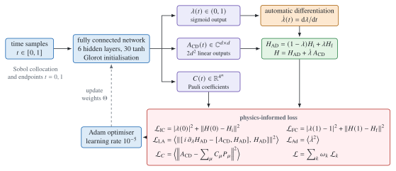

# Quantum PINN for optimal counterdiabatic driving

Code, data, and trained models accompanying
[Physics-informed neural networks for an optimal counterdiabatic quantum computation](https://doi.org/10.1088/2632-2153/ad450f),
*Machine Learning: Science and Technology* **5**, 025035 (2024)
([arXiv:2309.04434](https://arxiv.org/abs/2309.04434)), are collected here.

In counterdiabatic driving, the term $\dot\lambda(t)A_{\mathrm{CD}}(t)$ is
added to an adiabatic Hamiltonian, and with it a quantum state tracks the
instantaneous ground state even under fast evolution. What fixes this term is
the adiabatic gauge potential $A_{\mathrm{CD}}$, and for many-body systems that
potential is hard to compute. In this work one physics-informed neural network
(PINN), whose only input is time, learns all of the following at once:

- the scheduling function $\lambda(t)$,
- the gauge potential $A_{\mathrm{CD}}(t)$ as a complex matrix,
- the expansion coefficients $C_\mu(t)$ of $A_{\mathrm{CD}}$ over Pauli
  strings.

The method uses no reference solutions. Both the boundary conditions and the
variational (least-action) condition on the gauge potential are written into
the loss, and nothing has to be diagonalised. The main example is the H$_2$
molecule in the STO-3G basis on two qubits, and the scaling study adds LiH on
four qubits.

## Architecture

<picture>
  <source media="(prefers-color-scheme: dark)" srcset="datasets/figures/architecture/quantum-pinn-dark.svg">
  <source media="(prefers-color-scheme: light)" srcset="datasets/figures/architecture/quantum-pinn-light.svg">
  
</picture>

The total Hamiltonian is

$$
H(t)=\underbrace{\bigl(1-\lambda(t)\bigr)H_{\mathrm{initial}}+\lambda(t)H_{\mathrm{final}}}_{H_{\mathrm{AD}}(t)}+\dot\lambda(t)A_{\mathrm{CD}}(t),
\qquad t\in[0,1].
$$

Five weighted terms make up the loss: the endpoint conditions $\lambda(0)=0$,
$\lambda(1)=1$, $H(0)=H_{\mathrm{initial}}$, $H(1)=H_{\mathrm{final}}$; the
least-action residual
$\bigl[i\,\partial_\lambda H_{\mathrm{AD}}-[A_{\mathrm{CD}},H_{\mathrm{AD}}],H_{\mathrm{AD}}\bigr]=0$;
a penalty on $\dot\lambda^2$; and a term that matches $A_{\mathrm{CD}}$ to
$\sum_\mu C_\mu P_\mu$. Each definition, weight, and normalisation in the code
is spelled out in the [method guide](docs/method.md).

## Install and run

You need Python 3.10 or newer. Run these from the repository root:

```bash
python -m pip install -r requirements.txt
quantum-pinn train --experiment smoke --output datasets/runs/example
quantum-pinn evaluate datasets/runs/example/model.pt
quantum-pinn evaluate h2-d1.0
```

With the first command, a small network takes 30 Adam updates on CPU, which
lasts about a second, and its configuration, loss history, and weights are
written to disk. The second command loads that run again, and the third
evaluates the bundled H$_2$ model trained for the article. Every Hamiltonian
and trained model ships with the repository, so nothing is fetched at run time.
A good entry point is the [quickstart](docs/quickstart.md), followed by the
[Jupyter tutorials](docs/examples/README.md); full runs of 500000 updates are
described in the [training guide](docs/training.md).

## The counterdiabatic term switches on and off

<picture>
  <source media="(prefers-color-scheme: dark)" srcset="datasets/figures/counterdiabatic-dark.svg">
  <source media="(prefers-color-scheme: light)" srcset="datasets/figures/counterdiabatic-light.svg">
  
</picture>

Solid lines: Pauli coefficients of
$H_{\mathrm{CD}}=\dot\lambda A_{\mathrm{CD}}$ that the network learned for
H$_2$ at four bond distances. Dashed lines: the same schedule times the exact
gauge potential $A_\lambda$, found by diagonalisation. Only the $XY$ and $YX$
strings appear in the exact potential for this Hamiltonian, and their signs are
opposite; the network finds both, and across the interior 80% of the evolution
their relative error stays under 1%. In the lower panels the first and last 1%
of the evolution are enlarged. The loss demands $H(0)=H_{\mathrm{initial}}$ and
$H(1)=H_{\mathrm{final}}$, so the network turns the driving on and off inside
thin boundary layers. Between 1.0 and 2.0 Å the schedule does this work:
$\dot\lambda$ climbs from zero and falls back to zero within the first and last
0.3% of the evolution, and $A_{\mathrm{CD}}$ remains near the exact potential
throughout. At 2.5 Å the exact potential peaks at the start, and there the
network suppresses $A_{\mathrm{CD}}$ over the first 1% instead, while
$\dot\lambda$ is still close to 0.1. The largest matrix element of
$H_{\mathrm{CD}}$ at $t=0$ and $t=1$ is under $2\times10^{-4}$ Ha, whereas its
peaks lie between 0.23 and 2.8 Ha.

## The state stays in the ground state

<picture>
  <source media="(prefers-color-scheme: dark)" srcset="datasets/figures/energies-dark.svg">
  <source media="(prefers-color-scheme: light)" srcset="datasets/figures/energies-light.svg">
  
</picture>

Two propagations start from the ground state of $H_{\mathrm{initial}}$ (the
Hartree–Fock Hamiltonian): one under $H(t)$ with the learned schedule and
potential, and one under the same schedule with the counterdiabatic term
removed. Grey lines show the instantaneous eigenvalues of $H_{\mathrm{AD}}(t)$.
Coloured curves show $\langle H_{\mathrm{AD}}(t)\rangle$ in the top row and, in
the bottom row, the population of the instantaneous ground state. In units of
$\hbar/E_{\mathrm{h}}$ the whole evolution lasts 1, and over so short a time
the uncorrected schedule loses 3% to 40% of the ground-state population.

| Bond distance (Å) | Exact ground energy (Ha) | $\langle H_{\mathrm{final}}\rangle$ at $t=1$, with CD (Ha) | Relative error (%) | Ground population, with CD | Ground population, without CD |
| ---: | ---: | ---: | ---: | ---: | ---: |
| 1.0 | −1.101150 | −1.101150 | 2.2 × 10⁻⁷ | 1.000000 | 0.972 |
| 1.5 | −0.998149 | −0.998149 | 8.4 × 10⁻⁶ | 0.999999 | 0.877 |
| 2.0 | −0.948641 | −0.948634 | 7.6 × 10⁻⁴ | 0.999714 | 0.714 |
| 2.5 | −0.936055 | −0.936025 | 3.2 × 10⁻³ | 0.998882 | 0.596 |

[`src/figures.py`](src/figures.py) recomputes these numbers from the stored
predictions and writes them to
[`evaluation.json`](datasets/figures/evaluation.json). Compared with Table 1 of
the article, the eigenvalues of $H(t=1)$ differ by less than $1\times10^{-4}$
Ha at 1.0 and 1.5 Å and by less than $5\times10^{-4}$ Ha at 2.0 and 2.5 Å. The
propagated energy at 2.5 Å is −0.93603 Ha, nearer the exact value than the
−0.9347 Ha reported in the article. Since the bundled runs are not the
article's runs, [results](docs/results.md) lists how they differ.

## Training and the learned schedule

<picture>
  <source media="(prefers-color-scheme: dark)" srcset="datasets/figures/training-dark.svg">
  <source media="(prefers-color-scheme: light)" srcset="datasets/figures/training-light.svg">
  
</picture>

(a) The loss terms over the 500001 Adam updates of the H$_2$ run at 1.0 Å,
sampled at 3000 log-spaced updates. The boundary, least-action, and Pauli terms
drop under $10^{-4}$; the $\dot\lambda^2$ penalty levels off at its weight,
which is 0.1 here because $\dot\lambda\approx1$. (b, c) Each schedule is nearly
linear, with $\lambda(t)\approx t$ and $\dot\lambda\approx1$ away from the
endpoints. Once $\lambda(0)=0$ and $\lambda(1)=1$ are fixed, the linear
schedule exactly minimises $\int_0^1\dot\lambda^2\,\mathrm{d}t$. The penalty
therefore drives the schedule towards constant speed, and the gauge potential
takes care of correcting the dynamics. In the article this outcome is described
as a FAQUAD-like protocol.

## Repository contents

| Directory | Contents |
| --- | --- |
| [src/quantum_pinn/](src/quantum_pinn/) | Model, physics loss, training and evaluation, analysis, command line |
| [src/figures.py](src/figures.py) | Reproduces every figure and `evaluation.json` from the bundled data |
| [src/diagrams/](src/diagrams/) | TikZ source of the architecture diagram and its renderer |
| [src/verify.py](src/verify.py) | Privacy audit of the public files and data checksums |
| [datasets/](datasets/) | Hamiltonians, six trained models, stored trajectories, scalability table, configurations, figures |
| [docs/](docs/) | Method, installation, training, inference, results, data provenance, tutorials |
| [tests/](tests/) | Numerical, workflow, tutorial, and documentation tests |
| [summary/](summary/README.md) | Verification guide, repository map, and record of removed material |

How the paper's figures correspond to files here: Figure 1 → architecture
diagram; Figures 2 and 3 → [training](datasets/figures/training-light.svg);
Figures 4 and 6 →
[counterdiabatic matrix](datasets/figures/counterdiabatic-matrix-light.svg);
Figure 5 → [spectra](datasets/figures/spectra-light.svg); Figure 7 →
[Pauli coefficients](datasets/figures/pauli-coefficients-light.svg); Figure 8 →
[scalability](datasets/figures/scalability-light.svg); Table 1 and eq. (17) →
[`evaluation.json`](datasets/figures/evaluation.json). Every figure is
reproduced in the [results guide](docs/results.md), together with the points
where the bundled runs depart from the article.

## Licence and patent notice

The software is distributed under the [Clear BSD License](LICENSE), and that
licence gives no patent rights. As the article declares, the authors filed a
patent application covering the method in August 2023; [PATENTS.md](PATENTS.md)
has the details. The data and trained models are covered by the terms in
[datasets/LICENSE.txt](datasets/LICENSE.txt). If you use this repository,
please cite the article; the reference is in [CITATION.cff](CITATION.cff).
