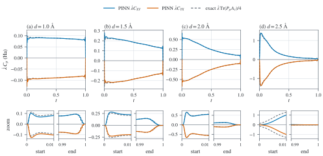
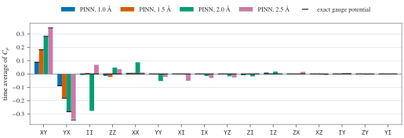
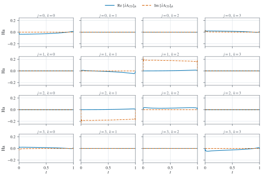
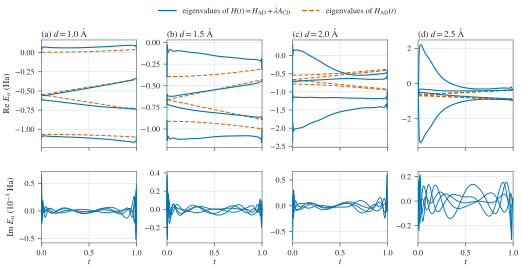
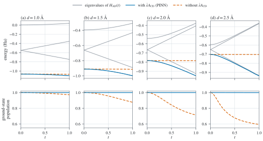
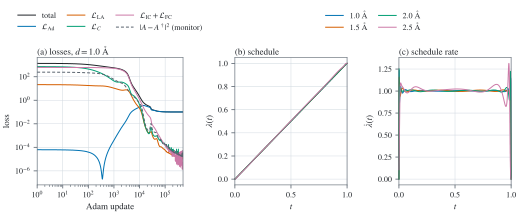
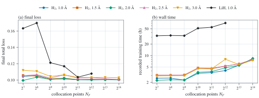

# Results

No training is involved: all figures and numbers in this guide are generated
from the bundled data by

```bash
python -m pip install '.[figures]'
python src/figures.py
```

which needs roughly half a minute on a laptop CPU. The script saves a light and
a dark SVG of every figure in `datasets/figures/`, along with the numerical
record [`evaluation.json`](../datasets/figures/evaluation.json). The same
numbers can be computed step by step in the
[reproduction tutorial](examples/reproduce-results.ipynb).

## Inputs

The H$_2$ predictions are taken from the article's training runs and stored at
10000 uniform times in
[`h2-trajectories.h5`](../datasets/results/h2-trajectories.h5). At 1.0 Å the
source is the 500001-update run, and at 1.5, 2.0 and 2.5 Å the runs with 2048
collocation points. From the stored $\lambda$, $\dot\lambda$ and
$A_{\mathrm{CD}}$, the total Hamiltonian is reconstructed as
$H=(1-\lambda)H_{\mathrm{initial}}+\lambda H_{\mathrm{final}}+\dot\lambda A_{\mathrm{CD}}$.

Dynamics: starting from the ground state of $H_{\mathrm{initial}}$,
$i\,\partial_t\psi=H(t)\psi$ ($\hbar=1$) is integrated with SciPy's DOP853
method (relative tolerance $10^{-10}$, absolute $10^{-12}$), using a
piecewise-linear $H(t)$ on every fifth stored time (2000 points). For the
comparison without counterdiabatic driving, $\lambda(t)$ is kept and
$\dot\lambda A_{\mathrm{CD}}$ is removed. Populations and energies are divided
by the state norm. The reason is that the learned $A_{\mathrm{CD}}$ is
Hermitian only as far as the Pauli loss enforces it (the largest element of
$A_{\mathrm{CD}}-A_{\mathrm{CD}}^\dagger$ lies between $2\times10^{-3}$ and
$1.6\times10^{-2}$).

## Counterdiabatic coefficients (article Figure 7)

<picture>
  <source media="(prefers-color-scheme: dark)" srcset="../datasets/figures/counterdiabatic-dark.svg">
  <source media="(prefers-color-scheme: light)" srcset="../datasets/figures/counterdiabatic-light.svg">
  
</picture>

$\dot\lambda C_{XY}$ and $\dot\lambda C_{YX}$ from the network (solid) and from
the exact gauge potential under the same schedule (dashed). The lower panels
cover $t\in[0,0.01]$ and $t\in[0.99,1]$. Only $XY$ and $YX$, with opposite
signs, appear in the projection of the exact potential
([method](method.md#what-the-outputs-mean)).

<picture>
  <source media="(prefers-color-scheme: dark)" srcset="../datasets/figures/pauli-coefficients-dark.svg">
  <source media="(prefers-color-scheme: light)" srcset="../datasets/figures/pauli-coefficients-light.svg">
  
</picture>

Time averages of the learned $C_\mu$, ordered by mean magnitude, with
horizontal marks for the exact gauge potential. In agreement with the article,
$C_{XY}$ and $C_{YX}$ are the largest, carry opposite signs, and increase with
bond distance. For $C_{XY}$ from 1.0 to 2.5 Å the time averages are 0.087,
0.183, 0.282, 0.341, against exact values of 0.088, 0.182, 0.283, 0.345. The
exact potential has no counterpart for the next largest coefficients, $C_{II}$,
$C_{ZZ}$ and $C_{XX}$. Because $C_{II}$ commutes with every Hamiltonian, it is
pure gauge freedom. Its time average at 2.0 Å is −0.28.

## Matrix elements of the counterdiabatic term (article Figures 4 and 6)

<picture>
  <source media="(prefers-color-scheme: dark)" srcset="../datasets/figures/counterdiabatic-matrix-dark.svg">
  <source media="(prefers-color-scheme: light)" srcset="../datasets/figures/counterdiabatic-matrix-light.svg">
  
</picture>

Real (solid) and imaginary (dashed) parts of every element of
$\dot\lambda A_{\mathrm{CD}}$ at 1.0 Å. The largest elements form the
imaginary, antisymmetric pair $(1,2)$ and $(2,1)$, which couples $|01\rangle$
with $|10\rangle$. This pair is the $XY-YX$ structure of the exact potential.
The small real diagonal elements belong to the identity and to $Z$-type
strings.

## Spectra (article Figure 5)

<picture>
  <source media="(prefers-color-scheme: dark)" srcset="../datasets/figures/spectra-dark.svg">
  <source media="(prefers-color-scheme: light)" srcset="../datasets/figures/spectra-light.svg">
  
</picture>

Eigenvalues of the full $H(t)$ (solid) and of $H_{\mathrm{AD}}(t)$ (dashed).
Over most of the evolution, the counterdiabatic term pushes the lowest
eigenvalue of $H(t)$ away from the rest, most strongly at 2.0 and 2.5 Å. The
imaginary parts, around $10^{-4}$ Ha, arise from the small anti-Hermitian part
of the learned $A_{\mathrm{CD}}$. Note that the state is not transported along
the eigenvalues of $H(t)$. The relevant instantaneous energies are those of
$H_{\mathrm{AD}}(t)$, plotted in the next figure.

## Ground-state preparation (article Table 1)

<picture>
  <source media="(prefers-color-scheme: dark)" srcset="../datasets/figures/energies-dark.svg">
  <source media="(prefers-color-scheme: light)" srcset="../datasets/figures/energies-light.svg">
  
</picture>

| Bond distance (Å) | Re eigenvalues of $H(t=1)$ (Ha) | Exact ground energy (Ha) | $\langle H_{\mathrm{final}}\rangle$, with CD | Relative error (%) | Article $E_{\mathrm{final}}$ | Article $\varepsilon$ (%) |
| ---: | --- | ---: | ---: | ---: | ---: | ---: |
| 1.0 | −1.1012, −0.7459, −0.3523, 0.0390 | −1.101150 | −1.101150 | 2.2 × 10⁻⁷ | −1.1011 | 1 × 10⁻⁴ |
| 1.5 | −0.9981, −0.8906, −0.4315, −0.3072 | −0.998149 | −0.998149 | 8.4 × 10⁻⁶ | −0.9981 | 2 × 10⁻⁴ |
| 2.0 | −0.9487, −0.9245, −0.4063, −0.3764 | −0.948641 | −0.948634 | 7.6 × 10⁻⁴ | −0.9486 | 5 × 10⁻³ |
| 2.5 | −0.9361, −0.9316, −0.3672, −0.3613 | −0.936055 | −0.936025 | 3.2 × 10⁻³ | −0.9347 | 1.5 × 10⁻¹ |

For the relative error, $\langle H_{\mathrm{final}}\rangle$ at $t=1$ is
compared with the exact ground energy of $H_{\mathrm{final}}$. When the
counterdiabatic term is dropped, the same schedule finishes with ground-state
populations of 0.972, 0.877, 0.714 and 0.596 and with energies of −1.0694,
−0.9131, −0.7851 and −0.7036 Ha. When it is included, the populations remain
above 0.9988 for the entire evolution.

The network reproduces $H(1)=H_{\mathrm{final}}$ at $t=1$ within
$2\times10^{-4}$ Ha, which makes the first column effectively the spectrum of
$H_{\mathrm{final}}$. The exact ground energies are equal to the STO-3G
full-configuration-interaction energies of H$_2$ with nuclear repulsion
included (−1.10115 Ha at 1.0 Å, for example).

At 1.0 Å, the eigenvectors of $H(t=1)$ (article eq. 17), arranged as columns in
order of energy and with the largest component of each made real and positive,
are

$$
|0\rangle=(0,\ 0.9845,\ -0.1753,\ 0),\quad
|1\rangle=(-0.7071,\ 0,\ 0,\ 0.7071),\quad
|2\rangle=(0.7071,\ 0,\ 0,\ 0.7071),\quad
|3\rangle=(0,\ 0.1753,\ 0.9845,\ 0)
$$

in the basis $|00\rangle,|01\rangle,|10\rangle,|11\rangle$. The same four
vectors appear in the article, but in another order and with the components
arranged differently.

## Training history and schedule (article Figures 2 and 3)

<picture>
  <source media="(prefers-color-scheme: dark)" srcset="../datasets/figures/training-dark.svg">
  <source media="(prefers-color-scheme: light)" srcset="../datasets/figures/training-light.svg">
  
</picture>

Panel (a) plots the loss terms of the 1.0 Å run at 3000 log-spaced updates out
of 500001, although the stored history has every update. Final values are
$\mathcal L_{\mathrm{IC}}=2.1\times10^{-6}$, $\mathcal L_{\mathrm{FC}}=0$ (the
sigmoid saturates in single precision),
$\mathcal L_{\mathrm{LA}}=1.0\times10^{-5}$, $\mathcal L_C=1.6\times10^{-5}$,
and $\mathcal L_{\mathrm{Ad}}=0.1003$. Because the stored $\lambda$ arrays are
quantised in steps of roughly $5\times10^{-4}$, panel (b) shows $\lambda$
itself and not $\lambda-t$.

Figure 3 of the article shows the schedules after 15000, 25000 and 75000
updates. These intermediate states were not saved, but training with snapshots
regenerates them:

```bash
quantum-pinn train --experiment paper/h2-d1.0 --output datasets/runs/h2-paper
```

With this configuration, checkpoints after 15000, 25000 and 75000 updates are
written to `datasets/runs/h2-paper/snapshots/`, and
`quantum_pinn.load_checkpoint` loads them.

## Scalability (article Figure 8)

<picture>
  <source media="(prefers-color-scheme: dark)" srcset="../datasets/figures/scalability-dark.svg">
  <source media="(prefers-color-scheme: light)" srcset="../datasets/figures/scalability-light.svg">
  
</picture>

Final total loss and recorded wall time of 46 runs, taken from
[`scalability.csv`](../datasets/results/scalability.csv). They cover H$_2$ at
1.0–3.0 Å with $2^7$ to $2^{14}$ collocation points and LiH at 1.0 Å with $2^7$
to $2^{12}$. For H$_2$ the losses range from 0.0996 to 0.112, and most of each
is the $\mathcal L_{\mathrm{Ad}}$ floor of 0.1. For LiH the loss drops from
0.163 at $2^7$ points to 0.104 at $2^{11}$. The LiH runs lasted 33–71 h, the
H$_2$ runs 2.3–8.4 h. As in the article, LiH is several times more expensive
than H$_2$, and adding points beyond $2^{10}$–$2^{11}$ brings little
improvement in the loss. Absolute values are not those of the article, which
normalised losses to a minimum of 0.50 and measured times on an NVIDIA A100. No
record says which hardware produced the stored times.

## Differences from the article

What is bundled here are the retained outputs of the research code, and they
are not a new reproduction. Compared with the protocol stated in the article,
they differ as follows:

| Item | Article | Bundled models and data |
| --- | --- | --- |
| Hidden layers | 6 × 30 | 7 × 30 |
| $\omega_{\mathrm{Ad}}$, $\omega_C$ | 0.5, 250 | 0.1, 100 (inferred from the stored loss, $\mathcal L_{\mathrm{Ad}}\approx0.10$ at $\dot\lambda\approx1$, and from the code history) |
| Adam updates | 500000 | 500001 for the 1.0 Å trajectory; the historical scripts used 300001 ($N_F\ge2^{10}$) or 200001 ($N_F<2^{10}$) for the other runs |
| Loss normalisation in Figure 8 | relative to a minimum of 0.50 | absolute values |
| Hardware | NVIDIA A100 (40 GB) | not recorded |

The trained weights in `datasets/pretrained/` reproduce the stored trajectories
closely, though not exactly: the largest difference in $\lambda$ is between
$3\times10^{-4}$ and $10^{-3}$. They are therefore probably checkpoints from
runs close to the stored ones but not identical to them. This guide reports
results from the stored trajectories, and the pretrained models are there for
inference and fine-tuning. Training with the article's settings uses the
`paper/` and `scalability/` configurations from the
[training guide](training.md).
